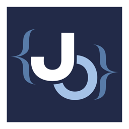
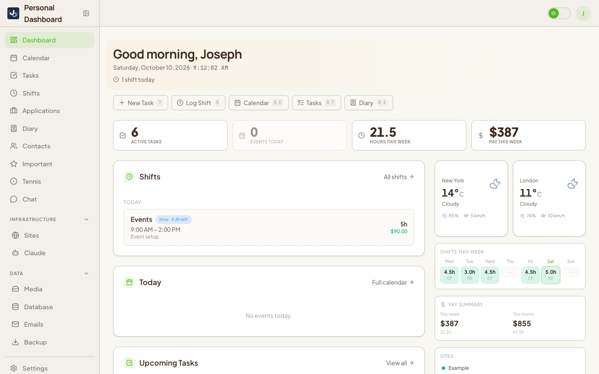
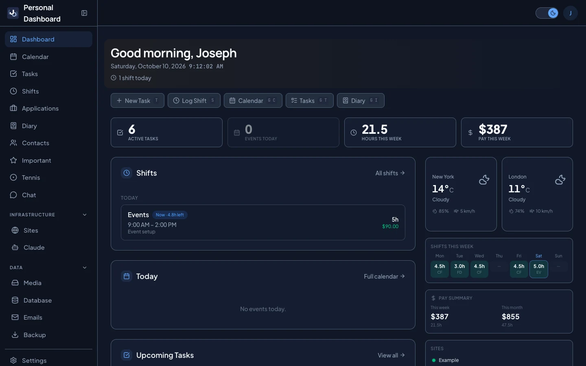
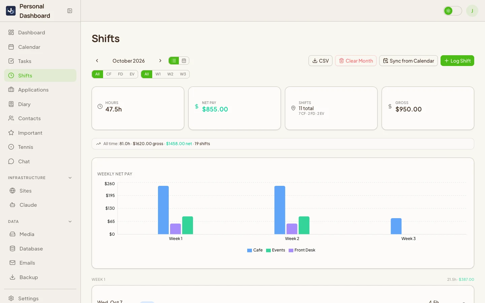
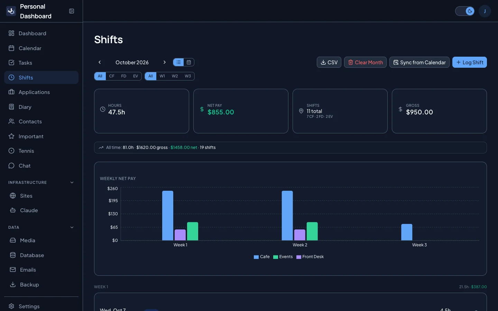
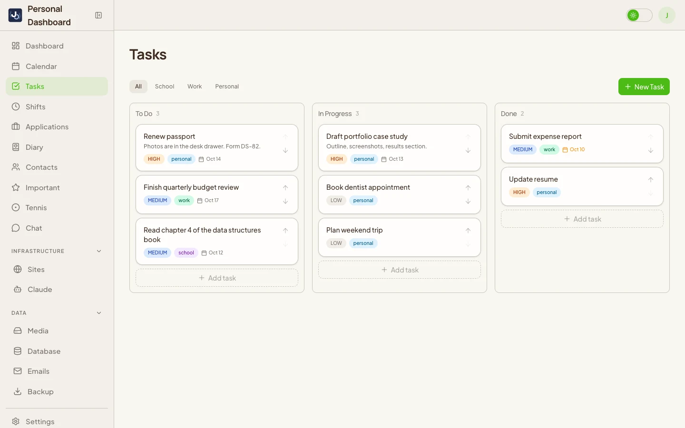
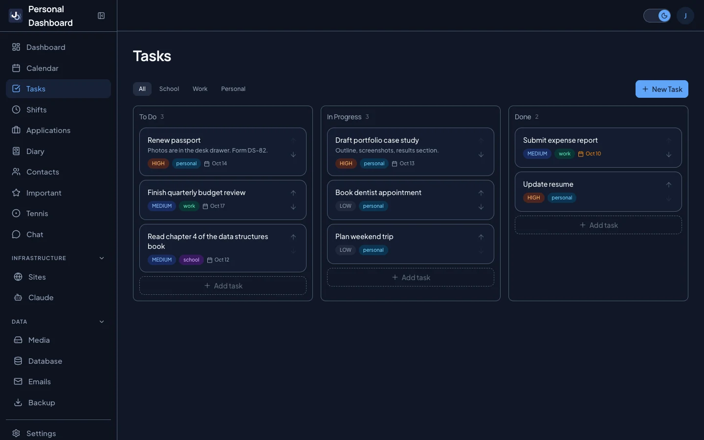

<div align="center">



# Personal Dashboard

**One screen for my whole life.**<br/>
Calendar, tasks, work shifts and earnings, job applications, a diary, and the sites I run.<br/>
Self-hosted, installable as a PWA, with push notifications.


<sub>The recording runs on invented demo data. Every task, company and number in it is made up.<br/>
Shorter cut: <a href="docs/demo-short.gif">demo-short.gif</a></sub>

</div>

## Why I built it


I'm an organized person and I like to see everything on one screen. Every new task or deadline meant opening another tab, and I kept forgetting where I put things: Google Keep for notes, a calendar for classes, a dozen tabs for everything else.

So in February 2026 I built the screen I wanted, and I have used it every day since.


The feature I open every day is **shifts and earnings**. It pulls my work schedule in from my calendar and shows what I will make this week. Scheduling apps like Workday and Humanity make you wait until the end of the pay period or count it by hand.

Some pages I built and later stopped using: a diary, a memory page, and my own chatbot. I kept them anyway, because the point was one place for everything. My own copy runs on my VPS as a PWA installed from Safari, next to a status page and an analytics app I also built.

<br clear="both"/>

### Why share it now

For about eight months this lived only on my own server. I never published it because I thought of it as my dashboard, built around my life and nobody else's. The more I thought about it, the more I wanted other people to have it too: to run their own dashboard, bend it to fit their own life, or take the idea and build something of their own.

This repository is a cleaned up public version of that dashboard. My personal data and the parts tied to my own servers are gone; everything else is here for you to run and make your own.

## Light and dark

<table>
  <tr>
    <td></td>
    <td></td>
  </tr>
  <tr>
    <td></td>
    <td></td>
  </tr>
  <tr>
    <td></td>
    <td></td>
  </tr>
</table>

## Features

| | |
|---|---|
| **Home** | Greeting, today's events, upcoming tasks and shifts, weekly pay, weather, site health, quick links |
| **Calendar** | Google Calendar with week, day and month views, multiple calendars, drag to create, move and resize, recurring events |
| **Tasks** | Kanban board with drag and drop, priorities, due dates, categories, photo attachments |
| **Shifts and earnings** | Log shifts or sync them from your calendar, gross and net pay, weekly chart, week view, CSV export |
| **Job applications** | Sortable table, status history, follow-up reminders, assessments, CSV import and export |
| **Diary** | One entry per day with mood, tags, photos and video, auto context from that day's shifts, tasks and events, optional AI summary, PDF export |
| **Contacts** | Searchable contact cards with tags, optional Google Contacts sync |
| **Important** | Topics that collect links, notes and files you want to find fast |
| **Tennis** | Rackets, restrings, string inventory, sessions and stroke ratings (a template for tracking any sport or hobby) |
| **AI chat** | Claude with tools over all of your dashboard data: ask, create and update in plain language |
| **Sites** | Uptime monitoring with 90 day history, response time charts, incidents and push alerts |
| **Media** | File library with image compression, video thumbnails and shareable links, stored on local disk or in Cloudflare R2 |
| **Backups** | JSON snapshots, CSV export, PDF report, optional Google Sheets sync and Google Drive backup |
| **Everything else** | Command palette (Cmd+K), keyboard shortcuts, push notifications, weekly summary email, database viewer, dark and light themes, cross device sync |

## Quick start (Docker)


You need [Docker](https://docs.docker.com/get-docker/) with Compose.

```bash
git clone https://github.com/JosephDavisC/Personal-Dashboard.git
cd Personal-Dashboard
cp .env.example .env
docker compose up -d --build
```

Open http://localhost:3000. The first build takes a few minutes.

The example `.env` starts in **demo mode**: no sign-in, and the database is filled with invented data. Google features (calendar, contacts, Drive) stay off until you add OAuth credentials, so the calendar page will ask you to sign in.

If port 3000 is taken, set `APP_PORT=3100` (or any free port) in `.env`.

To stop it: `docker compose down`. Add `-v` to also delete the database and uploaded media.

## Make it yours

**1. Edit the config files.** Identity and personal settings are compiled into the app, so rebuild after changing them (`docker compose up -d --build`).

| File | What it holds |
|---|---|
| [src/config/site.ts](src/config/site.ts) | App name, your first name, timezone, weather cities |
| [src/config/shifts.ts](src/config/shifts.ts) | Hourly wage, deduction rate, shift locations and the calendar keywords that detect them, optional supervisor contacts |

**2. Turn on Google sign-in.**

1. In [Google Cloud Console](https://console.cloud.google.com/), create a project and enable the Google Calendar API (plus People, Sheets and Drive if you want those features).
2. Create an OAuth client ID of type "Web application" with the redirect URI `http://localhost:3000/api/auth/callback/google` (or your own domain).
3. In `.env`, set `GOOGLE_CLIENT_ID`, `GOOGLE_CLIENT_SECRET`, `ALLOWED_EMAILS` (the accounts allowed to sign in), and a real `NEXTAUTH_SECRET` from `openssl rand -base64 32`.
4. Set `DEMO_MODE=false`. For an empty dashboard instead of demo data, set `SEED_DEMO_DATA=false` before the first start.

**3. Add what you want.** Everything else is optional and documented in [.env.example](.env.example):

- `ANTHROPIC_API_KEY` for the AI chat and diary summaries
- `MEDIA_STORAGE=r2` plus R2 credentials to keep uploads in Cloudflare R2 (see below)
- SMTP settings for share emails and the weekly summary
- VAPID keys for push notifications (`npx web-push generate-vapid-keys`)
- Cron tokens to turn on scheduled jobs. The `cron` service in compose already calls the site monitor and push reminders every minute once their tokens are set. Each endpoint stays disabled while its token is empty.

## Install it on your phone

The dashboard is a PWA, so it installs like an app: full screen, its own home screen icon, and push notifications. This is how I use mine every day.

**Before you start**

- It has to be served over **HTTPS** from a real domain. Phones will not install or send push notifications for a plain `http://` address, so do this after [deploying](#where-to-host-it).
- Generate push keys once with `npx web-push generate-vapid-keys`, put them in `.env` as `VAPID_PUBLIC_KEY` and `VAPID_PRIVATE_KEY`, and set `VAPID_SUBJECT=mailto:you@example.com`.
- For shift, task and diary reminders, also set `PUSH_CRON_SECRET` (the `cron` service then checks every minute). Site down alerts need `SITES_CRON_SECRET`.
- Restart: `docker compose up -d`.

**iPhone and iPad** (iOS 16.4 or newer)

1. Open your dashboard in **Safari** and sign in.
2. Tap the **Share** button, then **Add to Home Screen**, then **Add**.
3. Open the dashboard **from the new home screen icon**. On iOS, notifications only work inside the installed app, not in a Safari tab.
4. Go to **Settings** (bottom of the sidebar), tap **Enable Notifications**, and allow them when iOS asks.
5. Tap **Test** to send yourself a notification, then pick which alerts you want: shift reminders, tasks due, site down, diary reminders and more.

**Android**

1. Open the dashboard in **Chrome**, tap the **⋮** menu, then **Install app** (or **Add to Home screen**).
2. Open it from the icon, go to **Settings**, tap **Enable Notifications**, and allow them.

**Mac and Windows**

In Chrome or Edge, click the install icon at the right end of the address bar. Safari on macOS: **File, Add to Dock**. Notifications are enabled the same way, from **Settings**.

Each device you enable shows up under Settings, where you can remove it later.

## Store media in Cloudflare R2 (optional)

By default, uploads live on local disk in the `media` Docker volume. To keep them in a [Cloudflare R2](https://developers.cloudflare.com/r2/) bucket instead:

1. In the Cloudflare dashboard, create an R2 bucket (for example `dashboard-media`). Keep it private: the app serves files itself, so passwords, expiry dates and private files keep working.
2. Under **R2, Manage API tokens**, create a token with **Object Read and Write** on that bucket. Copy the Access Key ID, the Secret Access Key, and your Account ID.
3. In `.env`:

   ```bash
   MEDIA_STORAGE=r2
   R2_ACCOUNT_ID=your-account-id
   R2_ACCESS_KEY_ID=...
   R2_SECRET_ACCESS_KEY=...
   R2_BUCKET=dashboard-media
   ```

4. `docker compose up -d` to restart the app.

New uploads are still compressed and thumbnailed on the server first, then moved to the bucket (`media/` for files, `thumbs/` for thumbnails). Video streaming with range requests, downloads, the AI chat, the weekly summary email and Drive backups all read from R2 transparently. Files uploaded before the switch stay on disk; copy them to the bucket under `media/` and `thumbs/` with the same names if you want everything in one place.

`R2_ENDPOINT` is only needed for an EU or FedRAMP jurisdiction bucket, or to point at any other S3 compatible server.

## Deploying


This app is built for one person. Before putting it on the internet:

- Set `DEMO_MODE=false`. Demo mode turns off authentication completely.
- Set a strong `NEXTAUTH_SECRET` and `DB_PASSWORD`.
- Put it behind a reverse proxy with HTTPS (Caddy, Nginx, Traefik). Compose binds the app to `127.0.0.1` only. See [Where to host it](#where-to-host-it).
- Set `NEXTAUTH_URL` to your public URL and add the matching redirect URI in Google Cloud Console.
- Review [src/app/privacy/page.tsx](src/app/privacy/page.tsx) if you publish your OAuth consent screen.

## Where to host it

I run mine on a Hostinger VPS with Docker Compose, behind a reverse proxy with HTTPS, next to a few other apps of mine. Any of these work:

| Option | Fit | Notes |
|---|---|---|
| **Any VPS** (Hostinger, DigitalOcean, Hetzner, Linode, a home server) | Best | Clone the repo, fill in `.env`, `docker compose up -d --build`. Everything in this repo, including the cron service, just runs. Add a reverse proxy (Caddy is the easiest) for HTTPS. |
| **Railway, Render, Fly.io** | Good | Deploy the [Dockerfile](docker/Dockerfile) as a service and add their managed Postgres. Set the env vars from [.env.example](.env.example) plus `DATABASE_URL`. Attach a persistent volume at `/data/media`, or use `MEDIA_STORAGE=r2` and skip the volume. Run migrations once from your machine with `DATABASE_URL=... pnpm prisma migrate deploy`, and point the platform's cron (or [cron-job.org](https://cron-job.org)) at `/api/sites/cron?token=...` and `/api/push/cron?token=...` every minute. |
| **Vercel, Netlify** | Not recommended | Serverless functions have no ffmpeg or pdftoppm (video and PDF thumbnails and video compression are skipped), no persistent disk (R2 becomes required), and a request body limit of a few MB, far below the 500 MB upload limit. The rest of the app can run there, but media uploads will not. |

## Local development

```bash
docker compose -f docker-compose.dev.yml up -d   # Postgres on localhost:5432
pnpm install
cp .env.example .env        # then uncomment the DATABASE_URL line at the bottom
pnpm prisma migrate deploy
pnpm db:seed                 # optional demo data
pnpm dev
```

Useful scripts: `pnpm type-check`, `pnpm lint`, `pnpm build`.

## Tech stack

Next.js 16 (App Router) · React 19 · TypeScript · Tailwind CSS 4 · shadcn/ui · PostgreSQL · Prisma 7 · Auth.js (NextAuth v5) · TanStack Query · Recharts · dnd-kit · Anthropic SDK · Web Push · Docker

## License

[MIT](LICENSE) © Joseph Davis Chamdani. The Jo logo and chibi art are mine and are not covered by the license; the app ships with its own neutral logo.
