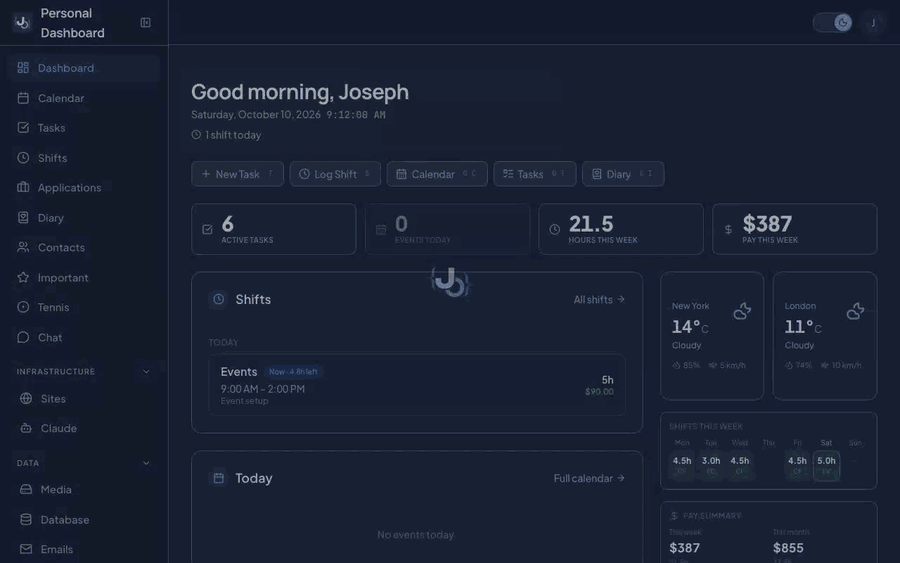
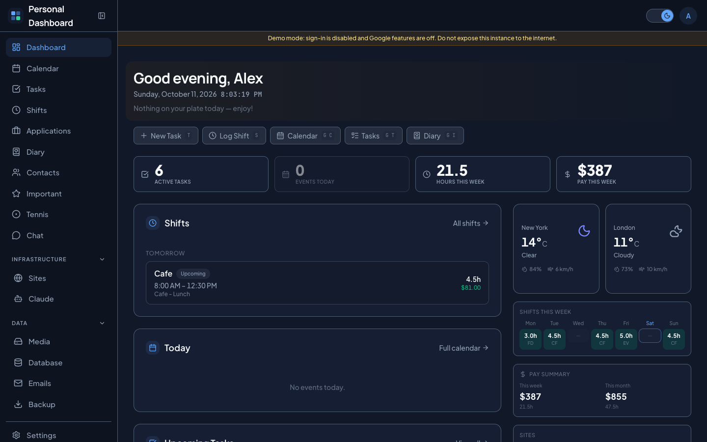
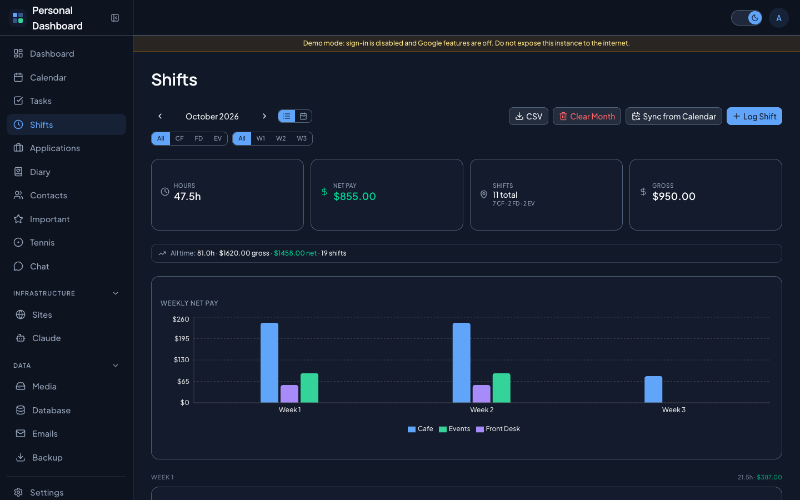

# Personal Dashboard

One screen for my whole life: calendar, tasks, work shifts and earnings, job applications, a diary, and the sites I run. Self-hosted, installable as a PWA, with push notifications.



> The recording runs on invented demo data. Every name, company and number in it is made up.

## Why I built it

I'm an organized person and I like to see everything on one screen. Every new task or deadline meant opening another tab, and I kept forgetting where I put things: Google Keep for notes, a calendar for classes, a dozen tabs for everything else.

So one quiet quarter I built the screen I wanted, and I have used it every day since.

The feature I open every day is **shifts and earnings**. It pulls my work schedule in from my calendar and shows what I will make this week. Scheduling apps like Workday and Humanity make you wait until the end of the pay period or count it by hand.

Some pages I built and later stopped using: a diary, a memory page, and my own chatbot. I kept them anyway, because the point was one place for everything. My own copy runs on my VPS as a PWA installed from Safari, next to a status page and an analytics app I also built.

This repository is a cleaned up public version of that dashboard. My personal data and the parts tied to my own servers are gone; everything else is here for you to run and make your own.

## Features

| | |
|---|---|
| **Home** | Greeting, today's events, upcoming tasks and shifts, weekly pay, weather, site health, quick links |
| **Calendar** | Google Calendar with week, day and month views, multiple calendars, drag to create, move and resize, recurring events |
| **Tasks** | Kanban board with drag and drop, priorities, due dates, categories, photo attachments |
| **Shifts and earnings** | Log shifts or sync them from your calendar, gross and net pay, weekly chart, week view, CSV export |
| **Job applications** | Sortable table, status history, follow-up reminders, assessments, CSV import and export |
| **Diary** | One entry per day with mood, tags, photos and video, auto context from that day's shifts, tasks and events, optional AI summary, PDF export |
| **Contacts** | Searchable contact cards with tags, optional Google Contacts sync |
| **Important** | Topics that collect links, notes and files you want to find fast |
| **Tennis** | Rackets, restrings, string inventory, sessions and stroke ratings (a template for tracking any sport or hobby) |
| **AI chat** | Claude with tools over all of your dashboard data: ask, create and update in plain language |
| **Sites** | Uptime monitoring with 90 day history, response time charts, incidents and push alerts |
| **Media** | File library with image compression, video thumbnails and shareable links |
| **Backups** | JSON snapshots, CSV export, PDF report, optional Google Sheets sync and Google Drive backup |
| **Everything else** | Command palette (Cmd+K), keyboard shortcuts, push notifications, weekly summary email, database viewer, dark and light themes, cross device sync |

<p>
  
  
</p>

## Quick start (Docker)

You need [Docker](https://docs.docker.com/get-docker/) with Compose.

```bash
git clone https://github.com/JosephDavisC/personal-dashboard.git
cd personal-dashboard
cp .env.example .env
docker compose up -d --build
```

Open http://localhost:3000. The first build takes a few minutes.

The example `.env` starts in **demo mode**: no sign-in, and the database is filled with invented data. Google features (calendar, contacts, Drive) stay off until you add OAuth credentials, so the calendar page will ask you to sign in.

If port 3000 is taken, set `APP_PORT=3100` (or any free port) in `.env`.

To stop it: `docker compose down`. Add `-v` to also delete the database and uploaded media.

## Make it yours

**1. Edit the config files.** Identity and personal settings are compiled into the app, so rebuild after changing them (`docker compose up -d --build`).

| File | What it holds |
|---|---|
| [src/config/site.ts](src/config/site.ts) | App name, your first name, timezone, weather cities |
| [src/config/shifts.ts](src/config/shifts.ts) | Hourly wage, deduction rate, shift locations and the calendar keywords that detect them, optional supervisor contacts |

**2. Turn on Google sign-in.**

1. In [Google Cloud Console](https://console.cloud.google.com/), create a project and enable the Google Calendar API (plus People, Sheets and Drive if you want those features).
2. Create an OAuth client ID of type "Web application" with the redirect URI `http://localhost:3000/api/auth/callback/google` (or your own domain).
3. In `.env`, set `GOOGLE_CLIENT_ID`, `GOOGLE_CLIENT_SECRET`, `ALLOWED_EMAILS` (the accounts allowed to sign in), and a real `NEXTAUTH_SECRET` from `openssl rand -base64 32`.
4. Set `DEMO_MODE=false`. For an empty dashboard instead of demo data, set `SEED_DEMO_DATA=false` before the first start.

**3. Add what you want.** Everything else is optional and documented in [.env.example](.env.example):

- `ANTHROPIC_API_KEY` for the AI chat and diary summaries
- SMTP settings for share emails and the weekly summary
- VAPID keys for push notifications (`npx web-push generate-vapid-keys`)
- Cron tokens to turn on scheduled jobs. The `cron` service in compose already calls the site monitor and push reminders every minute once their tokens are set. Each endpoint stays disabled while its token is empty.

## Deploying

This app is built for one person. Before putting it on the internet:

- Set `DEMO_MODE=false`. Demo mode turns off authentication completely.
- Set a strong `NEXTAUTH_SECRET` and `DB_PASSWORD`.
- Put it behind a reverse proxy with HTTPS (Caddy, Nginx, Traefik). Compose binds the app to `127.0.0.1` only.
- Set `NEXTAUTH_URL` to your public URL and add the matching redirect URI in Google Cloud Console.
- Review [src/app/privacy/page.tsx](src/app/privacy/page.tsx) if you publish your OAuth consent screen.

## Local development

```bash
docker compose -f docker-compose.dev.yml up -d   # Postgres on localhost:5432
pnpm install
cp .env.example .env        # then uncomment the DATABASE_URL line at the bottom
pnpm prisma migrate deploy
pnpm db:seed                 # optional demo data
pnpm dev
```

Useful scripts: `pnpm type-check`, `pnpm lint`, `pnpm build`.

## Tech stack

Next.js 16 (App Router) · React 19 · TypeScript · Tailwind CSS 4 · shadcn/ui · PostgreSQL · Prisma 7 · Auth.js (NextAuth v5) · TanStack Query · Recharts · dnd-kit · Anthropic SDK · Web Push · Docker

## License

[MIT](LICENSE) © Joseph Davis Chamdani
